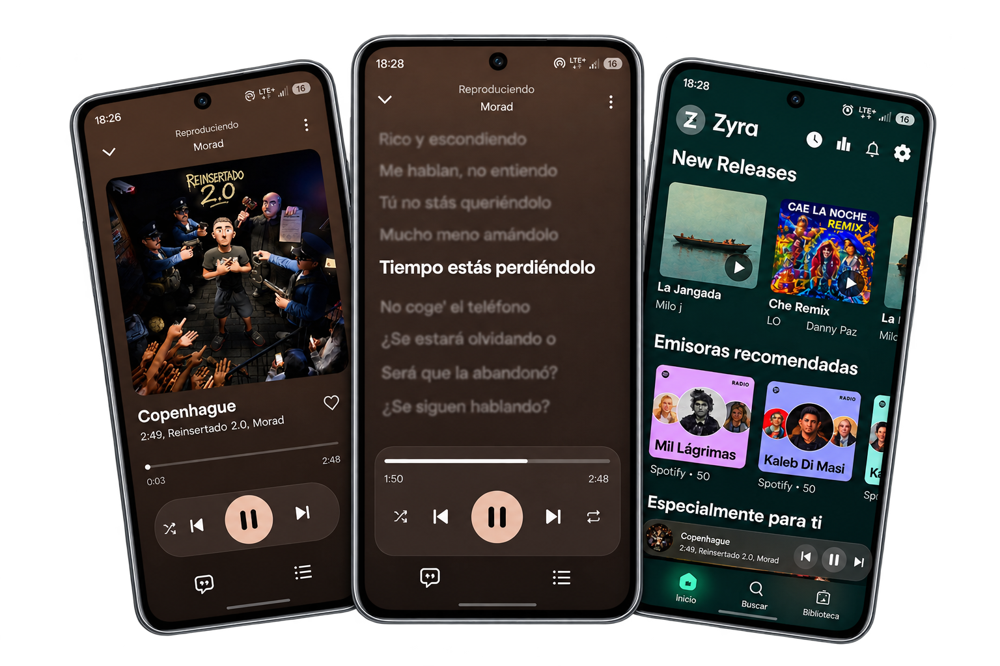

# Zyra

### Tu música, sin límites. **Gratis y sin anuncios.**

Un reproductor de música para Android, bonito, rápido.

[**⬇️ Descargar la última versión**](https://github.com/fg-error/zyra/releases/latest)

---

## ¿Qué es Zyra?

**Zyra** es una app de música para Android pensada para quienes quieren disfrutar de su música sin interrupciones. Sin suscripciones, sin publicidad entre canciones y sin pagar nada: abres la app, buscas lo que quieres y le das play.

Con un diseño moderno, un reproductor muy cuidado y letras sincronizadas, Zyra convierte escuchar música en una experiencia que se siente premium… pero es **gratis**.

---

## 🎵 Funciones

- **Reproductor completo**: portada grande, controles, barra de progreso, aleatorio, repetir y favoritos.
- **Letras sincronizadas**: pantalla de letras con la línea actual resaltada.
- **Descubre música nueva**: lanzamientos, emisoras recomendadas y sugerencias personalizadas en la pantalla de inicio.
- **Busca lo que quieras**: encuentra canciones, artistas y álbumes rápido.
- **Tu biblioteca**: guarda tus favoritas y organiza tus listas de reproducción.
- **Importa desde Spotify**: trae tus listas a Zyra y sigue escuchando lo que ya amas.
- **Íconos alternativos**: cambia el ícono de la app por el que más te guste.
- **Paletas y estilos**: personaliza los colores y el estilo del reproductor.
- **Integraciones**: compatibilidad con Last.fm y reconocimiento de canciones.
- **Actualizaciones fáciles**: entérate de las nuevas versiones directamente desde la app.

---

## ⬇️ Instalación

1. Ve a la sección de [**Releases**](https://github.com/fg-error/zyra/releases/latest).
2. Descarga el archivo `.apk` más reciente.
3. Ábrelo en tu teléfono Android y permite la instalación desde fuentes desconocidas si te lo pide.
4. ¡Listo! Abre Zyra y empieza a escuchar.

> **Requisito:** un dispositivo con Android.

---

## ❓ Preguntas frecuentes

**¿Zyra es realmente gratis?**
Sí. Es gratis y lo seguirá siendo: no hay suscripción ni funciones bloqueadas por pago.

**¿Tiene anuncios?**
No. Zyra no muestra publicidad.

**¿Necesito crear una cuenta?**
No es necesario para empezar a usarla.

**¿Dónde la descargo?**
Desde la página de [Releases](https://github.com/fg-error/zyra/releases/latest) de este repositorio.

---
